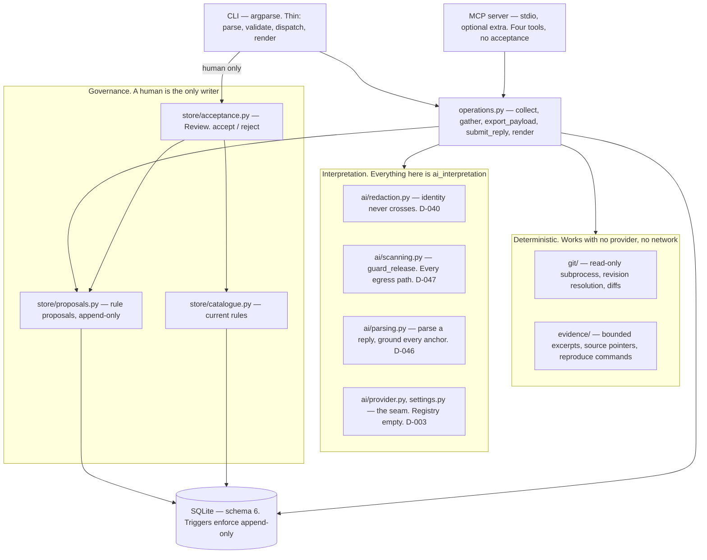
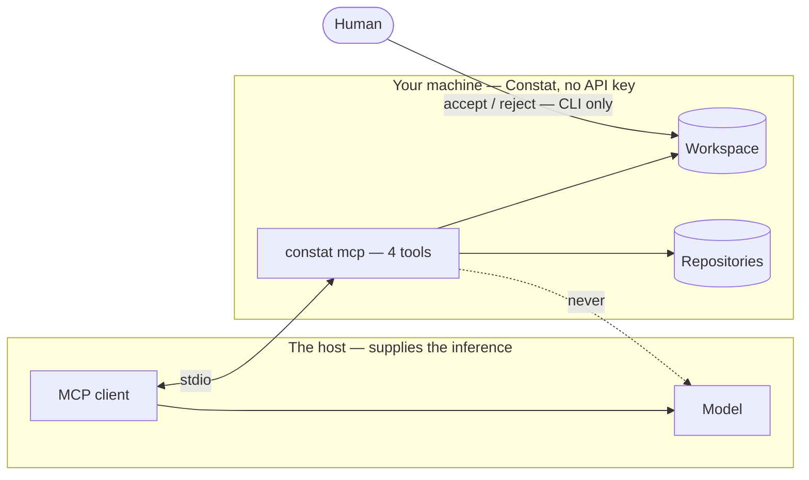

# Constat — Architecture

Version 0.2 · 2026-11-12 · **implemented through CON-50**; §§ 2–4 describe the code as it is

This document describes the *smallest* architecture that supports the MVP in
[PRODUCT_SPEC.md](PRODUCT_SPEC.md) § 6, and the shape to grow into afterwards. Keep the first
version deliberately boring: the goal is to validate the product workflow, not to demonstrate
infrastructure sophistication.

---

## 1. Technology choices

| Area | Start with | Why |
| --- | --- | --- |
| Language / interface | Python CLI | Fast to build, easy to test, suitable for Git analysis and structured data. |
| Git access | `git` command line via `subprocess` | Uses Git's mature capabilities; avoid implementing Git internals. |
| Data validation | Pydantic | Enforces a stable schema for evidence and proposals. |
| Persistence | SQLite | Simple local persistence without running a database service. |
| Reports | Markdown | Readable, portable, easy to commit to a repository. |
| Tests | pytest | Protects the evidence, approval and versioning rules. |
| AI | Provider interface; optional, later | Keep deterministic evidence collection separate from AI interpretation. Avoid recurring API costs in the first prototype. |

**Deferred:** web dashboard, multi-tenant SaaS, authentication, billing, Kubernetes, Kafka, graph
database, multi-agent workflows, automatic approval.

## 2. Layers

The central constraint: **deterministic evidence collection is independent of AI interpretation**,
and **nothing becomes official without a human decision**. The layering exists to make those two
rules structurally enforced rather than merely intended.



Read the arrows as "may depend on". Two absences are the point: nothing in `DET` points into
`INT`, and nothing in `INT` points into `GOV`.

### Dependency rule

Each layer may depend only on layers above it in that list. In particular:

- The Git adapter and evidence engine **never** import the interpretation layer. The evidence path
  works with no AI provider configured, and no network (D-003, D-041).
- The interpretation layer **never** writes a rule. Only `Review`, driven by a human at the CLI,
  produces a rule version (D-048, D-053).
- **`ai/parsing.py` takes `(text, payload)` and nothing else.** It has no idea whether the text came
  from an HTTP response or an agent in the same terminal, which is what made D-045's change of
  direction cheap.
- **No MCP tool reimplements an operation.** Every one calls the same function the CLI does, so the
  gates hold there by construction rather than by being re-applied (D-055).
- Rendering is a pure function of stored structure. It must never discover new facts.

## 2.1 The workflow, driven from an AI implementation

This is the intended path (D-045). The **host supplies the model** — Constat never calls one, and
has no API key. Constat runs as a subprocess the client spawns over stdio; nothing listens on a
port.

```mermaid
sequenceDiagram
    actor Dev as Developer
    participant Host as MCP client
    participant Model
    participant Constat as constat mcp
    participant Repos as Registered repositories
    participant Store as Workspace

    Dev->>Host: "work out what ticket 622 changed"
    Host->>Constat: spawn on stdio · initialize · list_tools
    Constat-->>Host: gather_evidence · get_payload · submit_rules · list_rule_proposals

    Host->>Constat: gather_evidence(622)
    Constat->>Repos: resolve the ticket's commits, read-only
    Constat->>Store: record the run and one operation per repository
    Constat-->>Host: every repository searched, including those contributing nothing

    Host->>Constat: get_payload(622)
    Constat->>Constat: strip identity · scan for credentials
    Constat-->>Host: redacted evidence + the rule catalogue
    Note over Constat,Host: a credential here refuses instead of exporting

    Host->>Model: the payload, as context
    Model-->>Host: rules, behaviours, anchors · optionally "revises: N"

    Host->>Constat: submit_rules(622, reply)
    Constat->>Repos: re-gather — the caller's payload is never trusted
    Constat->>Constat: parse · ground every anchor against real evidence
    Constat->>Store: store what survives, append-only
    Constat-->>Host: stored · discarded with reasons · possible duplicates
    Note over Host,Model: nothing is accepted; no tool here can accept

    Host-->>Dev: N rule proposals awaiting your decision

    Dev->>Constat: constat rule accept 1 --by you
    Constat->>Store: baseline a frozen rule version
    Note over Dev,Store: the CLI is the only door to this step
```

### Where the model lives, and where the wall is



Two properties that diagram is drawing:

- **Constat never calls a model.** The dotted line is the arrow that does not exist. That is why
  the provider registry ships empty and why none of this needs an API key (D-003, D-041, D-045).
- **Acceptance has one door and a model is not behind it.** There is no `accept` tool, and a test
  asserts the live tool list to keep it that way (D-055).

### The same loop without an agent

Every tool is a CLI command, so the whole thing works by hand — which is how it is tested:

```
constat document 622 --payload > payload.json   # evidence out, through the gate
#   …any model, anywhere, reads it…
constat rule submit 622 --from reply.json       # grounded, stored, discards reported
constat rule proposals 622                      # the review queue
constat rule accept 1 --by you                  # a human decides
constat rule history 1                          # back to the reading, run and evidence
```

### Four refusals, each with a test

| Where | Refuses | Why |
| --- | --- | --- |
| Export | A payload carrying a credential | By the time it has printed, it has left (D-047) |
| Export | Author and committer identity, always | Rule generation needs *what* changed, never *who* (D-040) |
| Submit | A reading whose anchors are not in the evidence | Otherwise the tool invents its own evidence (D-046) |
| Submit | A reply that cannot be parsed | Returning nothing would read as "no rules were identified" (D-046) |
| Everywhere | Any non-human acceptance | No tool, CLI or MCP, can accept (D-048, D-055) |

## 3. Proposed package layout

As built. Compare with the git history rather than this list if they ever disagree.

```
constat/
  cli.py              # entry point; thin by design
  config.py           # input validation — shape only (D-016)
  errors.py           # one type per failure kind; exit codes 2–5
  models.py           # Pydantic: the published shapes, incl. RuleProposal
  globs.py            # one anchor matcher, shared by grounding and the catalogue
  operations.py       # collect, gather, export_payload, submit_reply, render
  mcp.py              # the MCP server (optional extra)
  git/
    adapter.py        # read-only discovery and revision resolution (D-019, D-020)
    diff.py           # merge-base comparison, renames, deletions (D-021, D-022)
  evidence/
    collector.py      # bounded excerpts, fair-share allocation (D-023, D-024)
  ai/
    redaction.py      # the privacy boundary (D-040)
    scanning.py       # credential detection and guard_release (D-044, D-047)
    parsing.py        # reply -> grounded rule proposals (D-046)
    provider.py       # Provider protocol, NullProvider (D-003, D-039)
    settings.py       # provider resolution; registry deliberately empty (D-041)
  store/
    schema.py         # schema 6 + migrations + append-only triggers
    workspace.py      # connection, versioning, transactions
    registry.py       # registered repositories (D-025, D-027, D-028)
    tickets.py        # tickets and their one document (D-029, D-032)
    catalogue.py      # current rules, matching, coverage
    proposals.py      # rule proposals and decisions, append-only (D-051)
    acceptance.py     # Review: accept / reject / history (D-053)
tests/                # 697 tests; conftest.py + helpers.py build throwaway repos
```

Not built: comments (CON-39, CON-47, CON-48), the Markdown report (CON-09), GitHub metadata and
PR linkage (CON-16, CON-17), remote clone-and-cache (CON-35).

## 4. Data model sketch

Subject to Session 07; recorded here so the shape is reviewable now.

- **Repository** — local path, resolved Git root, optional GitHub remote identity.
- **RevisionRange** — base revision, target revision, both resolved to full commit SHAs plus the
  symbolic name the user typed.
- **Commit** — SHA, author, committer, dates, message, parent SHAs (so merges are explicit).
- **FileChange** — path, previous path (renames), change type, line counts.
- **EvidenceItem** — provenance type, bounded excerpt, and a **source pointer** (`rev:path:lines`)
  that lets a reviewer re-derive the full original from Git.
- **Claim** — a single statement, its provenance type, and the evidence items supporting it. A claim
  with no supporting evidence must render as visibly uncertain.
- **ChangeProposal** — `schema_version`, stable identifier, repository, revision range, claims,
  classification, open questions for the reviewer, status (`proposed` / `approved` / `rejected`).
- **Decision** — reviewer identity (asserted, not authenticated), timestamp, action, rationale, the
  proposal content as decided.
- **Baseline** — append-only version row: proposal content at approval time, source revisions,
  content hash, previous baseline version. Never updated in place.

## 5. Integrity rules the tests must protect

These are the "key historical-integrity rules" in acceptance criterion 7. They are listed here so a
test exists for each.

1. Approving a proposal creates a **new** baseline version; no existing baseline row is modified or
   deleted.
2. Earlier baseline content remains byte-recoverable after any number of later approvals.
3. A rejection is persisted with its rationale and remains traceable; it does not vanish.
4. No proposal reaches `approved` without a recorded human decision.
5. Every claim in a stored proposal has exactly one provenance type.
6. With no AI provider configured, the pipeline still produces a valid report containing zero
   `ai_interpretation` claims.
7. Evidence source pointers resolve back to real Git objects.
8. Parallel release streams do not collapse: baselines are keyed such that two branches can each
   have their own approved history.

## 6. Security posture

- Read-only against Git and GitHub. No writes, no commits, no pushes, no PR comments in the MVP.
- Credentials come from the environment or an OS keychain — **never** from files in this repository.
  GitHub access starts with least-privilege, read-only scope on **one** repository.
- `.gitignore` must cover the local database, reports and any `.env`.
- No customer code, production secrets or personal data is sent to any tool or AI provider without
  checking applicable policies and permissions first.

## 7. After the MVP

Expand only when a pilot exposes a concrete need. The sensible future shape:

- **Connectors** — Git repositories, pull requests, issues, CI/test results, API specifications,
  schema registries.
- **Evidence and change engine** — deterministic extraction and normalisation, independent of the AI
  provider.
- **Product knowledge model** — capabilities, services, repositories, releases, change groups,
  traceability links.
- **Interpretation layer** — AI proposes impact and plain-language explanations, always tied to
  evidence and uncertainty.
- **Governance** — human review, approvals, rejection rationale, immutable baselines, audit history.
- **Interfaces** — CLI first; then GitHub integration, an API and possibly MCP; a dashboard only when
  users need one.
- **Deployment** — local-first for the prototype; evaluate hosted or self-hosted based on customer
  security needs.

### Expansion order

1. **Next:** GitHub App or GitHub Action, PR ingestion, multiple repositories, explicit change
   grouping.
2. **Then:** product capability model, service/API/event/schema relationships, release streams,
   richer traceability.
3. **Then:** team review workflows, roles, audit export, self-hosted deployment, organisation-level
   policies.
4. **Later:** hosted dashboard, integrations, advanced analytics, commercial plans, AI-provider
   options.
